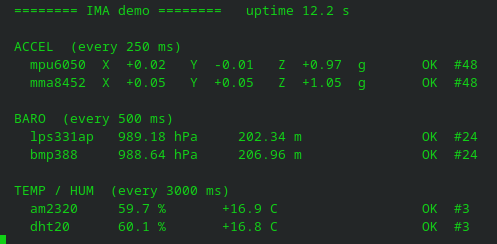

# IMA (Integrated Modular Avionics) simulation on ESP32
An educational model of **Integrated Modular Avionics (IMA)** on ESP32 microcontroller, written in pure C (ESP-IDF).

Six sensors are grouped into three functional units, two sensors of different types in each. The units run as independent FreeRTOS tasks and share one I2C bus. 
A separate display function shows the state of the whole system on a terminal dashboard.

## How it relates to IMA
| IMA principle | How it is done here |
|---:|---:|
| Partitioning into functions | each unit is a separate FreeRTOS task with its own period and priority |
| Shared computing resourses | one ESP32 processor for all units |
| Shared data network | one I2C bus for all sensors, access through a mutex |
| Dissimilar redundancy | each unit has two sensors from different manufacturers measuring the same quantity |
| Fault tolerance | if one sensor does not answer, the unit keeps working on the other; a failure of one unit does not stop the others |
| Separate display function | the dashboard receives data from the units but knows nothing about the sensor themselves |

---

## Hardware
| Unit | Sensor | Module | Measures | I2C address |
|---:|---:|---:|---:|---:|
| ACCEL | MPU6050 | HW-123 | acceleration X/Y/Z | 0x68 (AD0 -> GND) |
| ACCEL | MMA8452 | GY-45 (MMA845X) | acceleration X/Y/Z | 0x1C (SA0 -> GND) |
| BARO | LPS331AP | Pololu | pressure, altitude | 0x5D (SA0 = 1) |
| BARO | BMP388 | BMP388 module | pressure, altitude | 0x77 (SD0 -> VDD) |
| TEMP / HUM | AM2320 | - | humidity, temperature | 0x5C |
| TEMP / HUM | DHT20 | - | humidity, temperature | 0x38 |

Board: **ESP32** or **ESP32-S3**. The code is the same for both.

---

## What you see
The dashboard is redrawn in place every 250 ms.



Status column
| Status | Meaning |
|---:|---:|
| `starting...` | the sensor is still initializing |
| `OK #N` | the last read was good; N = number of good reads |
| `READ FAIL: <code>` | the last read failed, old values are shown |
| `INIT FAIL: <code>` | the sensor did not start and is not used |

---

## Project structure 

```
├── CMakeLists.txt
├── main/
│   └── ima_simulation.c   units (tasks), dashboard layout, axis alignment, app_main
│                          
└── components/
    ├── shared_i2c/        shared I2C bus + mutex; all bus access goes through it
    │                      
    ├── dashboard/         terminal dashboard: stores sensor states and draws the frame
    │                      
    ├── mpu6050/           MPU6050 accelerometer driver 
    ├── mma8452/           MMA8452 accelerometer driver 
    ├── lps331ap/          LPS331AP barometer driver 
    ├── bmp388/            BMP388 barometer driver, with NVM calibration 
    ├── am2320/            AM2320 humidity sensor driver, CRC16
    │                      
    └── dht20/             DHT20 humidity sensor driver 
```

Every component has the same layout:

- `include/<name>.h` — public functions called by `main`;
- `<name>.c` — implementation, everything internal is `static`;
- `CMakeLists.txt` — component description for the build.

Drivers do not create the bus themselves. They add their sensor to the shared bus through `shared_i2c_add_device()`.

---

## Units 

| Unit | Sensors | Period | FreeRTOS priority |
|---:|---:|---:|---:|
| `unit_accel` | MPU6050 + MMA8452 | 250 ms | 5 |
| `unit_baro` | LPS331AP + BMP388 | 1000 ms | 4 |
| `unit_hum` | AM2320 + DHT20 | 3000 ms | 3 |
| `dashboard` | — | 250 ms | 2 |

Each unit initializes its own sensors, so the long AM2320 start-up (~5 s) does not delay the other units. The period is kept with `vTaskDelayUntil`.

---

## Configuration 

| What | Where | What it does |
|---:|---:|---:|
| `USE_DASHBOARD` | `main/ima_simulation.c` | `1` = dashboard, `0` = plain log, useful for debugging |
| `DASHBOARD_PERIOD_MS` | `main/ima_simulation.c` | dashboard refresh period |
| `UNIT_*_PERIOD_MS` | `main/ima_simulation.c` | unit periods, at least 2000 ms for `unit_hum` |
| `BOARD_I2C_SDA_GPIO`, `BOARD_I2C_SCL_GPIO` | `main/ima_simulation.c` | bus pins (піни шини) |
| `MMA8452_AXES` | `main/ima_simulation.c` | how the MMA8452 is turned relative to the MPU6050, conversion to common axes |
| `*_SCL_SPEED_HZ` | each sensor driver | I2C speed for this sensor |
| `BMP388_SEA_LEVEL_HPA`, `LPS331_SEA_LEVEL_MBAR` | barometer drivers | sea-level pressure for the altitude formula |


